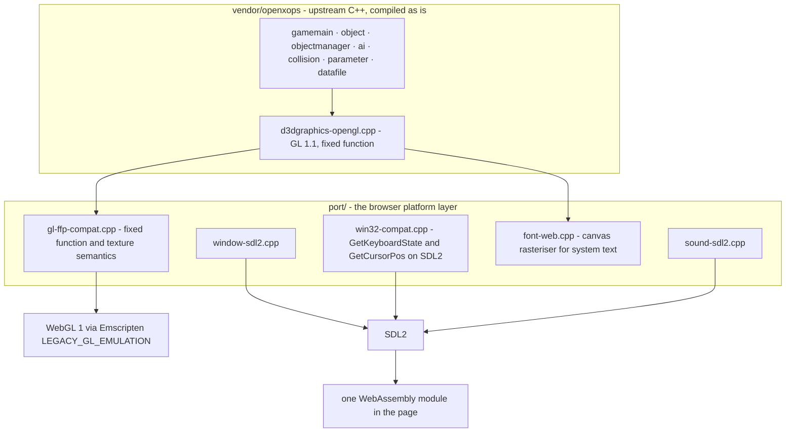
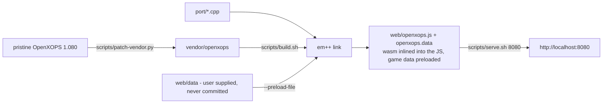

# xops: OpenXOPS in the browser

An **unofficial** browser port of OpenXOPS 1.080, the open-source remake of
*X operations*: the original C++ game compiled to WebAssembly with Emscripten,
rendering through WebGL 1, driven by SDL2. The whole FPS is here, not a
reimplementation: menus, briefing, missions, AI, collision, weapons, effects,
sound and the debug console all come from the upstream sources. Only the
platform layer was replaced.

This is not the official OpenXOPS and it ships no game data. Read
[LICENSE.md](LICENSE.md) before redistributing anything. Working on the code?
[AGENTS.md](AGENTS.md) has the rules that are easy to get wrong.

## Architecture

The engine has three layers, and only the lowest one touches the OS, which makes
it the entire port surface. Everything above it compiles verbatim.



| Upstream piece | Windows | Browser |
| --- | --- | --- |
| `window.cpp` | Win32 window, `timeGetTime` | `port/window-sdl2.cpp`, `SDL_GetTicks` |
| `input.cpp` | `GetKeyboardState`, `GetCursorPos` | kept, via `port/win32-compat.cpp` |
| `sound-ezds.cpp` | `ezds.dll` through `LoadLibrary` | `port/sound-sdl2.cpp`, software mixer |
| `d3dgraphics-opengl.cpp` | GL 1.1, WGL context, GDI fonts | GL 1.1 through the emulation, canvas text |
| `main.cpp` | `WinMain` and a message loop | `port/main-web.cpp`, `emscripten_set_main_loop` |

Upstream data formats needed no work at all: `.bd1` blocks, `.pd1` points, `.mif`
missions, `.dds`/`.bmp` textures and `.wav` sounds are parsed by the original
`datafile.cpp` and texture loaders. `port/glu.cpp` supplies the three GLU entry
points Emscripten does not ship.

## Build



`vendor/openxops/` is upstream plus the patches recorded in
`scripts/patch-vendor.py`, which is the single place vendor edits are documented,
with the Japanese comments translated to English (see the limitations below).
Required: [emsdk](https://github.com/emscripten-core/emsdk) in `.emsdk/`, and the
*X operations* 0.96 data (freeware by nine-two, from
[Vector](https://www.vector.co.jp/soft/win95/game/se284467.html)) copied into
`web/data/`.

```sh
cd .emsdk && ./emsdk install latest && ./emsdk activate latest   # once
bash scripts/build.sh          # a few seconds
bash scripts/serve.sh 8080
```

The build writes to a temp directory, links the wasm into the JS (`-sSINGLE_FILE`,
so one artifact cannot be served half-updated) and only then swaps it into `web/`
with a cache-busting stamp. Reloading mid-build used to mix a new wasm with an old
JS and hand the page broken GL state. `scripts/check.py` syntax-checks every
translation unit in parallel and is the fast loop while working on the shims.

URL parameters: `?mif=missions/building.mif` loads a mission directly,
`&nobriefing=1` skips the briefing, `&dir=data/map0` sets the working directory,
`&log=1` enables the debug log. `web/missions/` holds two small example missions.

## Controls

Same as *X operations*: `WASD` move, mouse look, left and right mouse button fire
and aim, `R` reload, `Esc` menu, `F1` third person, `F2` simplified HUD, `Home`
draws your own arms and weapon, `F11` debug console, arrow keys look when no mouse
is captured. Click the canvas once to capture the mouse: the browser needs that
gesture, and so does the game.

## Frame


## Verified

Against the full original data set in Chromium: opening credits and main menu
(mission list, scroll cursor, live demo behind it), briefing, missions for the
official TRAINING YARD and BUILDING maps, walking, mouse look, firing, weapon
switching, the first-person arms, third person and simplified HUD modes, the debug
console, and the sky. The frame counter holds 33.33fps, the fixed 30ms step the
game's timers assume. No JavaScript errors, and the only console noise is
Emscripten's own GL emulation warnings plus clearly labelled `[OpenXOPS]` output.

## Rendering bugs fixed

| Symptom | Cause | Fix |
| --- | --- | --- |
| Map blocks and models inside out, HUD glyphs smeared | The emulation relayouts client arrays by copying `count` vertices while still drawing `[first, first+count)`, so `glDrawArrays(GL_TRIANGLE_STRIP, 1, n-2)` read past the copy, and a strip's triangle parity sets winding | Draw from 0 with the full count and flip `glFrontFace` around those draws |
| Blurry grey floors, featureless characters | The game disables `GL_TEXTURE_2D` for surfaces it means to draw flat, and the emulation samples whatever texture is bound | `port/gl-ffp-compat.cpp` binds a 1x1 white texture for those draws and hands the game's binding back |
| Black title logo | `LoadTexture()` leaves `GL_REPEAT`, which WebGL 1 rejects on non-power-of-two textures | Clamp the wrap mode for NPOT textures |
| Sky missing entirely | Sky box faces come out back-facing under the port's view setup | Culling off for the two sky draws |
| Text and textures garbled after a weapon change or a mission exit | `SetTexture()`'s "already bound" cache survived `CleanupTexture()` and the binds `LoadTexture()` does behind its back | Drop the cache entry at both sites, and give back the state `port/font-web.cpp` borrows |
| Effects visible through walls | The OpenGL backend dropped the depth test for the effect pass, while the DirectX backend only drops depth writes | Keep the test, disable the writes: `glDepthMask(GL_FALSE)` |

Each fix in `vendor/openxops/` sits behind `#ifdef __EMSCRIPTEN__` so the file
still builds for Windows, and has an entry in `scripts/patch-vendor.py`.

## Known limitations

* Audio starts on the first user interaction, per browser autoplay policy.
* Pointer lock needs a click before mouse look works.
* `config.dat` lives in the in-memory file system; `web/index.html` mirrors it into
  `localStorage`, so options survive a reload but not a storage clear.
* Screenshots (the `ss` console command) only reach the in-memory file system.
* The browser text rasterizer replaces GDI fonts, so Japanese and Korean glyphs
  come from the viewer's browser rather than from MS Gothic.
* Comments in `vendor/openxops/` were translated to English, so that tree is no
  longer byte-identical to upstream. Code and string literals are unchanged.

## License

3-clause BSD, from the OpenXOPS Project. See [LICENSE.md](LICENSE.md): the full
text, the third-party parts that belong to nine-two and TENKUU, and the rule that
the original game's graphics data must not be redistributed.
