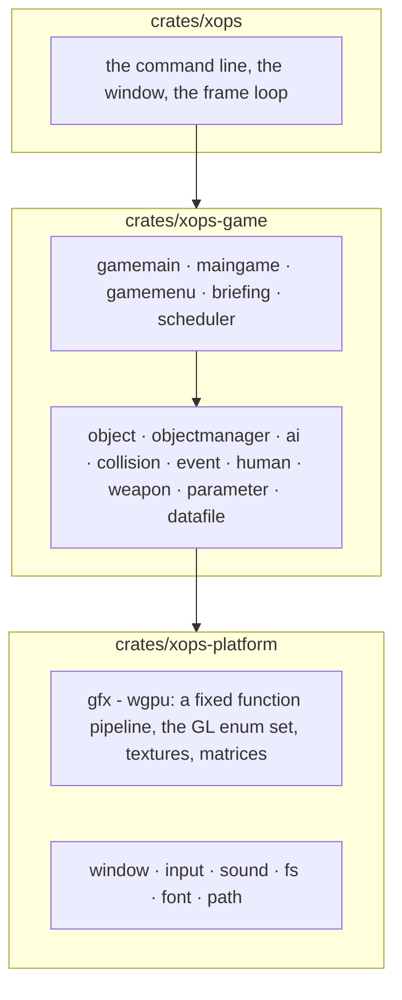
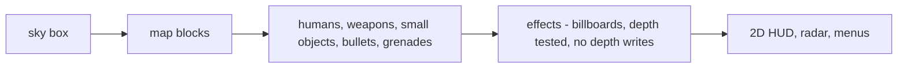

# xops: OpenXOPS for Windows, Linux and macOS

An **unofficial** port of OpenXOPS 1.080, the open-source remake of
*X operations*, as an ordinary game program: one binary per platform, no browser,
no runtime to install beyond the graphics and audio drivers you already have.

This is not a reimplementation. The whole FPS is here: the opening, the mission
menu with its live demo, the briefing, the missions, the AI, collision, weapons,
bullet and grenade physics, effects, sound, the radar, the HUD and the debug
console. The upstream C++ was rewritten in Rust rather than wrapped, and only the
layer that talks to the operating system is new.

It ships no game data. You need *X operations* 0.96, which nine-two released as
freeware, and [LICENSE.md](LICENSE.md) has the terms before you redistribute
anything. Working on the code? [AGENTS.md](AGENTS.md) has the rules that are easy
to get wrong.

## Build

A Rust toolchain, and one system package on Linux.

```sh
cargo build --release
```

| Platform | Result | Notes |
| --- | --- | --- |
| Windows | `target\release\xops.exe` | MSVC toolchain, no extra packages |
| Linux | `target/release/xops` | `libasound2-dev` to build (the audio backend), plus your usual OpenGL or Vulkan driver at run time |
| macOS | `target/release/xops` | nothing extra |

The binary is about 7 MB and self-contained. The build takes well under a minute
on a laptop.

## Run

The game's own paths are relative to the directory it runs in, so the data goes
in a `data` folder beside it, as it does for the original.

```sh
./target/release/xops                              # opening, then the menu
./target/release/xops --mission missions/training.mif   # straight into a mission
./target/release/xops --frames 60 --out frames     # offscreen, no window
```

| Option | What it does |
| --- | --- |
| `--dir PATH` | The directory the game's own paths are relative to. The current directory by default |
| `--mission PATH` | Start in this mission instead of at the opening screen |
| `--frames N` | Render N frames offscreen, write them to `--out`, exit |
| `--out DIR` | Where those frames go, as PNGs |
| `--size WxH` | Frame size for both modes, 640x480 by default |

`data/` is the *X operations* data and must not be redistributed. `missions/`
holds two example missions written for this port, and they use the official
TRAINING YARD and BUILDING maps, so they run against the original data.

## Controls

The game's own, which `config.dat` rebinds. The keys that are not configurable:

| Key | |
| --- | --- |
| `Esc` | Leave the current screen, back to the menu |
| `F1` | Third person: the camera pulls back over the player's shoulder |
| `F2` | Simplified HUD |
| `F11` | Debug console, and `help` lists its commands |

Movement, aiming and firing are the eighteen control keys in `config.dat`,
created with the original defaults on first run: `WASD` to move, mouse to look,
the mouse buttons to fire and aim, `R` to reload.

## Architecture

Three crates, and only the lowest one touches the operating system.



The split is the one the upstream is written with: everything above the platform
layer is a translation of the original C++, file for file and function for
function, and `PORTING.md` records how that translation is done.

| Upstream | Here |
| --- | --- |
| `main.cpp`, `gamemain.cpp` | `crates/xops/src/main.rs`, `gamemain.rs`, `scheduler.rs` |
| `maingame.cpp`, `gamemenu.cpp`, `briefing.cpp` | `maingame.rs`, `gamemenu.rs`, `briefing.rs` |
| `object.cpp`, `objectmanager.cpp`, `ai.cpp`, `collision.cpp` | the same names |
| `d3dgraphics.cpp` | `d3dgraphics.rs` over `xops-platform`'s `gfx` |
| `datafile.cpp` | `datafile.rs` |
| `window.cpp`, `input.cpp`, `sound.cpp` | `window.rs`, `input.rs`, `sound.rs` in each crate |
| `d3dgraphics-opengl.cpp` and the Direct3D 9 backend | one wgpu renderer |

The renderer is the one large piece that is not a translation. Upstream draws
through Direct3D 9 or OpenGL 1.1's fixed function pipeline, which no current API
has, so the subset those two use is reimplemented on wgpu: `glBegin`-style draw
calls, the matrix stacks, the blend and cull states, the texture formats the game
loads. The game code above it calls the same functions it always did.

## Frame



One pass is `Input`, `Process`, `Sound`, then one `RenderMain`, at the 30 ms step
the game's timers assume. The console's `speed` command repeats the first three
within a single drawn frame.

## Verified

Run, not read:

- The opening sequence, the menu with its demo, and a mission on the official
  TRAINING YARD map: the map, the player, other humans, the HUD panels, the
  weapon slot, the health readout and the mission clock.
- The debug console, over F11.
- The camera transform against the reference build's own recorded matrix: the
  rotation matches to three thousandths, and the map batches and their winding
  are identical.

And built, rather than run, for the other two platforms: the whole workspace
type-checks for `x86_64-pc-windows-msvc`, and it compiles clean inside a Linux
container with `libasound2-dev` installed. Neither has been played on, because
there is no Windows or Linux machine here: what is confirmed is that nothing in
the Rust is platform specific beyond the font paths, which all three have.

## Known limitations

- **Sound is wired but not verified by ear.** The mixer, the cue lists and the
  device output all run, and the browser build's audio graph is confirmed alive,
  but nobody has listened to the desktop build on hardware.
- `config.dat` is written where the game runs, so a read-only directory means
  settings do not persist. The game still starts with its defaults.
- A system font is looked up by path for the Japanese in the menus and weapon
  names. A machine with none of the listed fonts runs the game with that text
  missing rather than refusing to start.
- `.mif` files are read, and the two in `missions/` are written for this port.
  The original's mission files are not.

## License

3-clause BSD, from the OpenXOPS Project. See [LICENSE.md](LICENSE.md): the full
text, the third-party parts that belong to nine-two and TENKUU, and the rule that
the original game's graphics data must not be redistributed.
