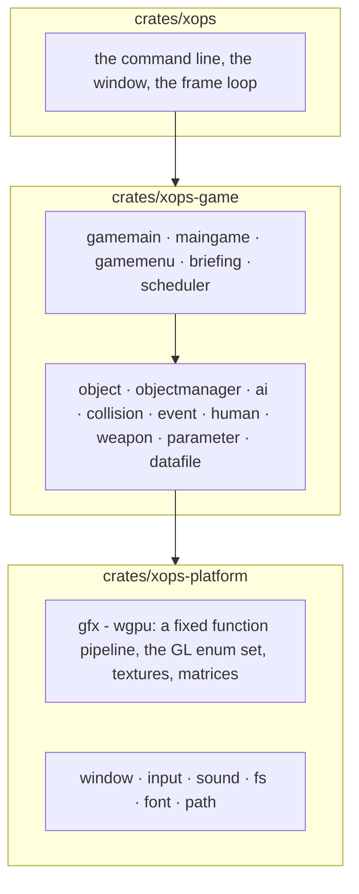
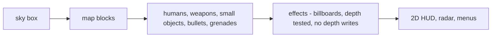

# xops: OpenXOPS for Windows, Linux and macOS

An **unofficial** port of OpenXOPS 1.080, the open-source remake of
*X operations*, as an ordinary game program: one binary per platform, no browser,
no runtime to install beyond the graphics and audio drivers you already have.

This is not a reimplementation. The whole FPS is here: the opening, the mission
menu with its live demo, the briefing, the missions, the AI, collision, weapons,
bullet and grenade physics, effects, sound, the radar, the HUD and the debug
console. The upstream C++ was rewritten in Rust rather than wrapped, and only the
layer that talks to the operating system is new.

It ships no game data. You need *X operations* 0.96, which nine-two released as
freeware, and [LICENSE.md](LICENSE.md) has the terms before you redistribute
anything. Working on the code? [AGENTS.md](AGENTS.md) has the rules that are easy
to get wrong.

## Build

A Rust toolchain, and one system package on Linux.

```sh
cargo build --release
```

| Platform | Result | Notes |
| --- | --- | --- |
| Windows | `target\release\xops.exe` | MSVC toolchain, no extra packages |
| Linux | `target/release/xops` | `libasound2-dev` to build (the audio backend), plus your usual OpenGL or Vulkan driver at run time |
| macOS | `target/release/xops` | nothing extra |

The binary is about 7 MB and self-contained. The build takes well under a minute
on a laptop.

## Run

### From nothing

The port is the program; the *data* is the original game's, and it is not in this
repository. Four steps, and the first one is the only one that needs anything from
outside:

1. **Get *X operations* 0.96.** It is freeware, by nine-two, and
   [LICENSE.md](LICENSE.md) has the link and the terms. Do not redistribute it.
2. **Put its `data` folder beside the binary.** The game's own paths are relative
   to the directory it runs in, so the layout is `data/` next to `xops`, as it is
   for the original. `--dir PATH` says so explicitly if you would rather run it
   from somewhere else, which is what a desktop shortcut needs.
3. **Run it.**

   ```sh
   ./target/release/xops
   ```

   The opening sequence plays, then the menu. The first run writes `config.dat`
   beside the binary: the key bindings, the window size and the sound volume all
   live there, and the game keeps them up to date as you change them in the menus.

4. **Play a mission.** The menu reaches them, and so does the command line:

   ```sh
   ./target/release/xops --mission missions/training.mif
   ```

If it starts and cannot find the data, it says which directory it looked in before
it gives up; that line is the answer to almost every "it will not start".

### The other ways to run it

```sh
./target/release/xops                              # opening, then the menu
./target/release/xops --mission missions/training.mif   # straight into a mission
./target/release/xops --frames 60 --out frames     # offscreen, no window
./target/release/xops --help                       # the options, briefly
```

`--frames` renders without opening a window, which is how the frames in a
comparison are produced and the only mode that works over SSH. Its frames are of
the original game's graphics: they are not to be committed or redistributed
either, and `frames/` is in `.gitignore` so that the example above cannot land
them in the repository by accident.

| Option | What it does |
| --- | --- |
| `--dir PATH` | The directory the game's own paths are relative to. The current directory by default |
| `--mission PATH` | Start in this mission instead of at the opening screen |
| `--frames N` | Render N frames offscreen, write them to `--out`, exit |
| `--out DIR` | Where those frames go, as PNGs |
| `--size WxH` | Frame size for both modes, 640x480 by default |

`data/` is the *X operations* data and must not be redistributed. `missions/`
holds two example missions written for this port, and they use the official
TRAINING YARD and BUILDING maps, so they run against the original data.

## Controls

The game's own, which `config.dat` rebinds. The keys that are not configurable:

| Key | |
| --- | --- |
| `Esc` | Leave the current screen, back to the menu |
| `F1` | Third person: the camera pulls back over the player's shoulder |
| `F2` | Simplified HUD |
| `F11` | Debug console, and `help` lists its commands |

Movement, aiming and firing are the eighteen control keys in `config.dat`,
created with the original defaults on first run: `WASD` to move, mouse to look,
the mouse buttons to fire and aim, `R` to reload.

## Architecture

Three crates, and only the lowest one touches the operating system.



The split is the one the upstream is written with: everything above the platform
layer is a translation of the original C++, file for file and function for
function, and `PORTING.md` records how that translation is done.
[docs/guide.md](docs/guide.md) is the way round the code: how a frame reaches the
screen, where the renderer's seam is, and which file to open first.

| Upstream | Here |
| --- | --- |
| `main.cpp`, `gamemain.cpp` | `crates/xops/src/main.rs`, `gamemain.rs`, `scheduler.rs` |
| `maingame.cpp`, `gamemenu.cpp`, `briefing.cpp` | `maingame.rs`, `gamemenu.rs`, `briefing.rs` |
| `object.cpp`, `objectmanager.cpp`, `ai.cpp`, `collision.cpp` | the same names |
| `d3dgraphics.cpp` | `d3dgraphics.rs` over `xops-platform`'s `gfx` |
| `datafile.cpp` | `datafile.rs` |
| `window.cpp`, `input.cpp`, `sound.cpp` | `window.rs`, `input.rs`, `sound.rs` in each crate |
| `d3dgraphics-opengl.cpp` and the Direct3D 9 backend | one wgpu renderer |

The renderer is the one large piece that is not a translation. Upstream draws
through Direct3D 9 or OpenGL 1.1's fixed function pipeline, which no current API
has, so the subset those two use is reimplemented on wgpu: `glBegin`-style draw
calls, the matrix stacks, the blend and cull states, the texture formats the game
loads. The game code above it calls the same functions it always did.

### Why wgpu

The graphics API is **wgpu**, and it is the whole of the engine: there is no scene
graph, no asset pipeline and no game loop of its own, because the game already has
all three and they are upstream's. What was needed is only what a platform layer
needs, a way to put triangles on the screen of whichever machine this is running
on.

- **It is the native API, not a browser one.** wgpu speaks Vulkan on Linux and
  Windows, Metal on macOS, and Direct3D 12 on Windows, whichever the driver
  offers. There is no WebGL or WebGPU anywhere in this build, and no browser.
- **It is the only cross-platform GPU API with first-class Rust support**, which
  matters because the whole game is Rust and the alternative is a C++ engine with
  a binding layer in front of it.
- **It is a thin abstraction.** The alternative candidates are engines: Bevy,
  Fyrox and the like bring their own ECS, their own asset system and their own
  opinions about how a frame is built. This game has all of that already, ported
  from upstream, and adopting an engine would mean rewriting it.
- **It costs nothing at build time.** One Cargo dependency, no SDK to install and
  no C toolchain beyond the one Rust already uses.
- **Its output was checked against the reference renderer** before this port grew
  the rest of the game, on identical recorded input, which is how the draw
  ordering, the winding and the uniform layout came to be trusted.

If a different choice were wanted, the seam is small and deliberate: everything
above `xops-platform`'s `gfx` module calls GL-shaped functions, so a different
backend would be a second implementation of that module rather than a rewrite of
the game.


## Frame



One pass is `Input`, `Process`, `Sound`, then one `RenderMain`, at the 30 ms step
the game's timers assume. The console's `speed` command repeats the first three
within a single drawn frame.

The game's step is the game's own rate, and the game is written for it: a frame
of movement is a frame's worth of movement, so running the step faster runs the
game faster. A display wants frames more often than that, though -- 33 frames a
second does not divide a 60 Hz refresh, so some frames are shown for one refresh
and some for two, which is what an uneven picture looks like even when the game
is keeping up. Between steps the host therefore draws the same frame again,
partway to the one before it, with each draw's matrices blended: the display gets
a frame every refresh and the simulation stays at its own rate. `XOPS_INTERPOLATE=0`
turns that off, which leaves exactly the frames the game makes.

The host paces those frames itself rather than leaving it to the display, so vsync
is off by default: that is what the engines do at a fixed target rate, and here it
is the smoother of the two by measurement -- fifty-five to fifty-eight frames a
second against thirty-nine to forty-two, with a much steadier gap between them. It
can tear, and `XOPS_VSYNC=1` hands the pacing back to the display's own
synchronisation for anyone who would rather have that.

`XOPS_TRACE=1` prints a line a second with the frame rate, the step's cost, the
mouse's movement as the platform received it and as the game took it, the player's
view angle, and where the HUD weapon was placed.

## Verified

CI runs four things on every push, on Linux: `cargo fmt --all --check`, `cargo clippy
--workspace --all-targets --all-features -- -D warnings`, `cargo check --workspace
--all-targets` and `cargo test --workspace`, with the tests under instrumentation for
coverage afterwards. macOS and Windows type-check, which is as much as a hosted runner
without a GPU can do. The tests that read the original game's data skip themselves
where it is absent, which is what a runner is; `cargo test -- --nocapture` names them.

And here, by hand, run rather than read:

- The opening sequence, the menu with its demo, and a mission on the official
  TRAINING YARD map: the map, the player, other humans, the HUD panels, the
  weapon slot, the health readout and the mission clock.
- The debug console, over F11.
- The camera transform against the reference build's own recorded matrix: the
  rotation matches to three thousandths, and the map batches and their winding
  are identical.

And on Linux, in a container: the whole workspace compiles, and the suite runs
under a software Vulkan driver with the renderer tests included. A container with
no driver fails those instead, which is fifty-three red lines with one cause
behind them.

Windows is checked rather than run: the whole workspace type-checks for
`x86_64-pc-windows-msvc`. There is no Windows machine here to play it on, so what
is confirmed is that nothing in the Rust is platform specific beyond the font
paths, which all three platforms have.

## Known limitations

- **Sound is wired but not verified by ear.** The mixer, the cue lists and the
  device output all run, but nobody has listened to them on hardware.
- `config.dat` is written where the game runs, so a read-only directory means
  settings do not persist. The game still starts with its defaults.
- A system font is looked up by path for the Japanese in the menus and weapon
  names. A machine with none of the listed fonts runs the game with that text
  missing rather than refusing to start.
- `.mif` files are read, and the two in `missions/` are written for this port.
  The original's mission files are not.

## License

3-clause BSD, from the OpenXOPS Project, whose notice sits in [LICENSE](LICENSE)
beside this port's own because this is a port of their work.
[LICENSE.md](LICENSE.md) has the longer notice: the third-party parts that belong
to nine-two and TENKUU, and the rule that the original game's graphics data must
not be redistributed.

**No game data is in this repository, and none has ever been committed.** The tree
holds source, the two example missions and two generated test fixtures; nothing else
in it is binary. `data/` is kept out by `.gitignore`, and no graphic, sound or
mission file of the original is in the repository or anywhere in its history --
checked by scanning every object it has ever held, by name, by extension and by file
signature, rather than assumed.

Nor is anybody else's source. The OpenXOPS 1.080 C++ is what this port was written
from and the reference for how it behaves, and a reference is not a dependency:
get it from the OpenXOPS Project at <https://openxops.net/>. What is here is this
port's own code, the two test fixtures it generated, and nothing else.
