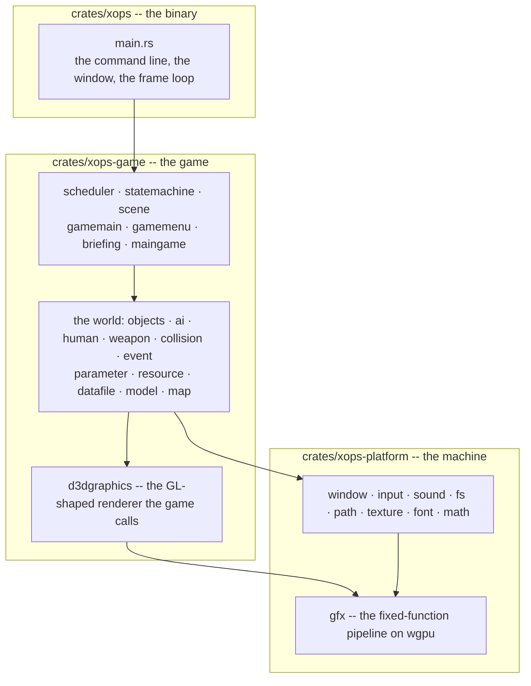
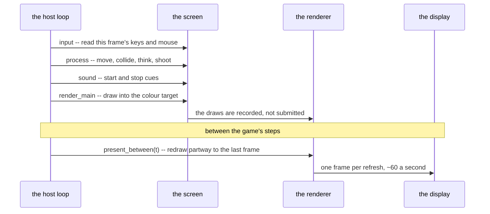
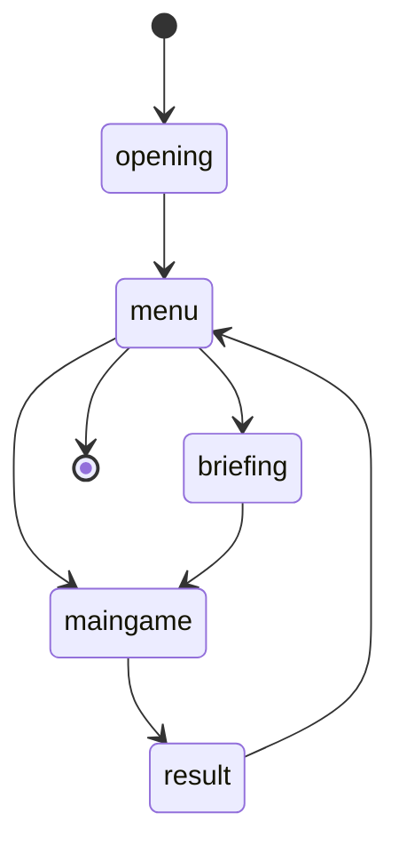
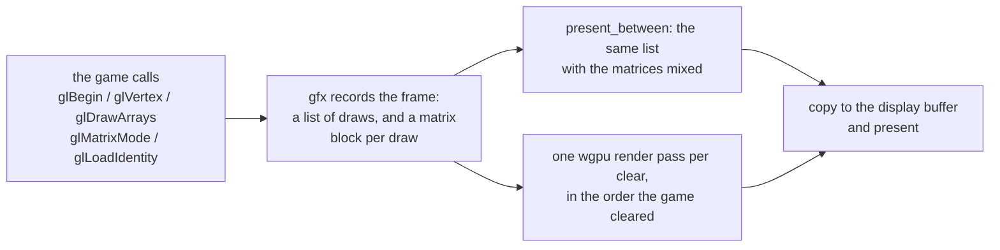
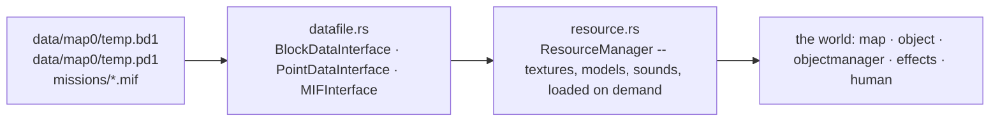

# A guide to the code

Where things are, how a frame gets to the screen, and which file to open when you want
to change something. Read [PORTING.md](../PORTING.md) first if you have not: it is the
contract this port is written under, and everything here assumes it. [AGENTS.md](../AGENTS.md)
has the rules that are easy to get wrong, and each one is there because it cost somebody
a day.

## Three crates, one seam

The seam is `d3dgraphics`: above it the game calls the functions it always called --
`SetWorldTransform`, `RenderModel`, `StartRender`, `EndRender` -- and below it `gfx`
turns those into wgpu. Everything above the seam is a translation of upstream's C++,
file for file and function for function. The platform layer is new, because the APIs
upstream used no longer exist anywhere.

**Which crate does a change belong in?** If upstream has a file that does the same
thing, the change is a port and it goes in `xops-game`. If it is about a window, a
device, a driver or a file on disk, it is `xops-platform`. `PORTING.md` has the table
that maps upstream file names onto modules.

## A frame

The game runs on a fixed 30 ms step -- `GAMEFRAMEMS`, which every movement, animation
and timer in it is written for -- and the host owns the clock. One step is four phases,
in this order, and the order is upstream's:

Two things about this are worth knowing before touching either end of it.

**The display is shown frames the game did not make.** A display wants sixty frames a
second and the game makes thirty-three, and the two never divide. So each frame between
steps is the game's own last frame drawn again with every draw's matrices blended
partway to the frame before it. That is what `present_between` does, and it is why the
same draw is recorded twice per step: once by the game, once by the host.

**A step draws, the host shows.** `Gfx::end_frame` draws into the colour target and
stops; `Gfx::set_host_presents` makes even that a no-op in the windowed run, because
the host is about to draw the same thing again with the blend applied. The offscreen
mode (`--frames`) reads the colour target and therefore leaves it on.

## The screens, and the world they own

There are five screens and one state machine. Each has a create, a running and a
destroy state, which is upstream's shape:

Every arrow is a destroy state choosing what comes next, and the differences are in the
game's own keys rather than in a screen: from the menu, F12 reaches the briefing and
anything else starts the mission; from the briefing, Back returns to the menu; from the
mission, F12 restarts it and Back abandons it to the menu. `--mission` sets the opening
state directly -- upstream's `ENABLE_AUTOLOADMIF` -- so a run can begin at the briefing
or in the mission itself, skipping the screens before it.

`Stage` in `scheduler.rs` moves the world from one screen to the next. **A screen owns
the world rather than borrowing it**, and that is not a style choice: a screen lives for
many frames, and a borrow of the world cannot be stored beside the world itself. The
same reason runs through the rest of the code -- the renderer, the sound manager, the
input state and the parameter tables are all passed in as arguments rather than held,
so that a screen can be a sibling of the things it uses. If you find yourself adding a
field that holds one of them, that is the trap this port already fell into once.

## Drawing: the fixed-function seam

Upstream draws through Direct3D 9 or OpenGL 1.1, both of which are gone. What is left
of them here is the subset the game actually used, reimplemented on wgpu:

Follow one draw to see it end to end:

1. The game calls `RenderModel`, which is `map.rs::render_model`. It looks the model up
   by id, interleaves the model's positions, colours and texture coordinates, flips the
   front face -- a strip drawn from vertex 0 has every triangle's winding reversed, and
   upstream draws from vertex 1 -- and calls `gfx.draw`.
2. `gfx.draw` writes a `Cmd::Draw` and a `Uniforms` (the matrices, the fog, the alpha
   reference) into the frame's lists. Nothing is submitted to the GPU here.
3. At the end of the step, `end_frame` walks the lists and opens a render pass wherever
   the game cleared, which is how the game's mid-frame depth clear becomes a pass
   boundary. The uniform block goes up as one buffer write.
4. Between steps, `present_between(t)` walks the *same* list and blends each draw's
   matrices with the frame before it, but only where the draw at that index is the same
   draw -- same geometry, same texture, same place in the list. A list that changed shape
   falls back rather than blending two things that were never in the same place.

The renderer is the one large piece of this port that is not a translation, so it is
also the one place where a change does not have a line of C++ to check against. The
tests in `crates/xops-platform/tests/render.rs` are what stands in for that: they
render headless, read the frame back, and check where the geometry landed. Each of
them started as a real defect -- a transform on the wrong stack, a winding that culled
the world away, a mid-frame clear that did not open a pass.

## The game's own data

`data/` is the original game's, is not in this repository, and must not be redistributed.
What reads it:

Two rules come with it. **`datafile::path_from_bytes` is the only place a path is
converted**: game paths are Shift-JIS bytes with backslashes, and a `Path` built
anywhere else will not resolve on Linux. And **the game's data is not the test suite's
data**: a test that reads `data/` must skip itself when it is absent, because CI has
none -- see issue #2 for the eight that still do.

## Where to start reading

1. `crates/xops/src/main.rs` -- the options, the host loop, and what owns what.
2. `crates/xops-game/src/gamemain.rs` -- `init_game`, which is the order everything is
   built in, and which the upstream calls `InitGame`.
3. `crates/xops-game/src/scheduler.rs` -- the state machine's dispatch, which is where a
   frame starts.
4. `crates/xops-game/src/maingame.rs` -- the mission screen, the largest file, and the
   one to open when the question is "what does the game do with this".
5. `crates/xops-platform/src/gfx.rs` -- the seam, if the question is about drawing.

Run what you change, rather than reading the diff: `cargo test --workspace` is the
suite and it is fast, `--frames N --out DIR` renders offscreen, and the four gates CI
runs are the four commands in [AGENTS.md](../AGENTS.md).
